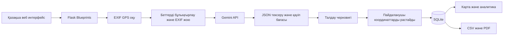
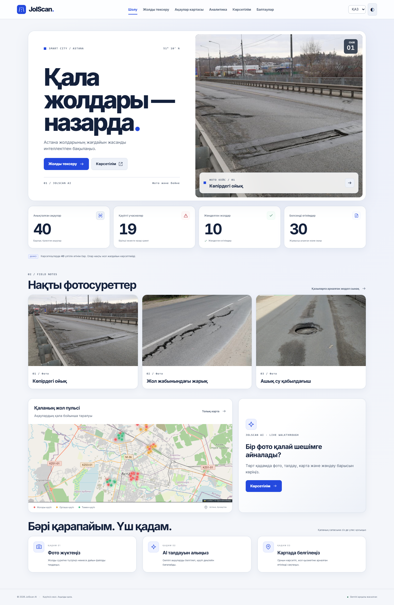
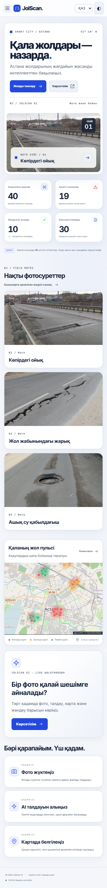

# JolScan AI · Қауіпсіз жол. Ақылды қала.

Астана жолдарының ақауларын фото және қысқа бейне арқылы тіркеуге арналған **қазақ, орыс және ағылшын тілдеріндегі** Flask веб-жүйесі. AI провайдері — тек **Google Gemini API**. YOLO, Hugging Face аккаунты, CUDA, React немесе frontend құрастыру қажет емес.

## Жылдам іске қосу

Python **3.11–3.12** ұсынылады. Алдымен жоба папкасын терминалда ашыңыз.

Windows PowerShell:

```powershell
python -m venv .venv
.\.venv\Scripts\python.exe -m pip install -r requirements.txt
Copy-Item .env.example .env
.\.venv\Scripts\python.exe run.py
```

macOS / Linux:

```bash
python3 -m venv .venv
.venv/bin/python -m pip install -r requirements.txt
cp .env.example .env
.venv/bin/python run.py
```

**Нақты AI талдауы үшін:** іске қоспас бұрын `.env` файлын редакторда ашып, `GEMINI_API_KEY=` жолына өз кілтіңізді енгізіңіз. [Google AI Studio](https://aistudio.google.com/apikey) арқылы алынады. Кілтті чатқа немесе Git-ке жарияламаңыз. `.env` өзгерген соң серверді қайта іске қосыңыз.

Сайт: **http://localhost:5000**. Кілтсіз сайт, карта, тізілім, демо және экспорт жұмыс істейді; жаңа фотода жалған AI нәтижесі жасалмайды. Талдау нақты кілтті сұрайды.

Демо деректер мен тесттер:

```powershell
.\.venv\Scripts\python.exe scripts/seed_demo.py
.\.venv\Scripts\python.exe -m pytest -q
```

macOS-та `.venv/bin/python` пайдаланыңыз. `python` виртуалды ортаға бағытталса, қысқа `python scripts/seed_demo.py` және `python run.py` командалары жарайды.

Демо генератор 40 **is_demo=True** өтінім жасайды. Суреттер Pillow арқылы бағдарламамен салынады; олар нақты фотолар емес. Бар демоны қайталамайды. Тазарту: «Баптаулар → Демо деректерін өшіру».

## Мүмкіндіктер

- Әдепкі ақ тақырып, көк акцент, швейцариялық типографиялық тор және мөлдір панельдер. Қараңғы тақырыпты мәзірден қосуға болады.
- Бір кезекте 8 файлға дейін; JPG/PNG/WebP және 30 секундқа дейінгі MP4/MOV/WebM. Бір сұрау 15 МБ-тан аспайды.
- Телефонның камерасы: «Суретке түсіру». Компьютерде веб-камера диалогы, тірі көрініс және кадр түсіру бар; жабылғанда камера ағыны тоқтайды. HEIC үшін камерада JPEG үйлесімділік режимін қосыңыз немесе JPEG-ке түрлендіріңіз.
- Бейнеден әр N-ші кадр, ең көбі 5 кадр талданады; параметр өзгертіледі. Кадрлар бөлек өтінім ретінде сақталады, қайталанатын ақаулар біріктірілмейді.
- Gemini JSON-жауабы: ақау атауы, шекарасы, жуық контуры және өзіндік сенімділік бағасы. Координаттар, диапазондар мен көпбұрыштар серверде тексеріледі.
- «Бастапқы / AI талдауы» жүгірткісі, жартылай мөлдір контурлар, ақау саны, қауіп және нақты сұрау уақыты.
- EXIF GPS бар болса алдымен алынады; болмаса браузер геолокациясын пайдаланушы қосады немесе картадан орынды басады. Сақтау үшін орынды растау міндетті.
- OpenCV Haar арқылы анықталған беттер **Gemini-ге дейін** жергілікті бұлыңғырланады. Сақталған екі JPEG-тен де EXIF алынады.
- Leaflet / OpenStreetMap (CSS арқылы қараңғыланған) картасы, нүктелер және жылу картасы; қауіп, мәртебе, аудан және күн бойынша сүзгілер.
- Chart.js диаграммалары: қауіп деңгейі, соңғы 14 күн, аудан. «Жаңа → Жөнделуде → Жөнделді» тізбегі.
- UTF-8 BOM CSV және қазақ әріптері бар DejaVuSans PDF. Экспорт тізілім сүзгілерін ескереді. PDF-те ең басым 20 белсенді өтінім мен 6 фото бар.
- SQLite, сессиялық CSRF қорғанысы, пайдаланушы мен әкімші рөлдері, қате файлдар/лимит/таймаут/бос жауап үшін түсінікті хабарлар.

## Жоба құрылымы

```text
app/
  __init__.py               # app factory, CSRF, headers
  config.py                 # thresholds, districts, provider configuration
  models.py                 # Report / Detection
  ai/detector.py            # Gemini REST, validation, contours, severity
  ai/privacy.py             # local face blur / EXIF removal
  services/geo.py           # EXIF GPS / approximate districts
  services/stats.py         # saved-report aggregates
  services/report_pdf.py    # Unicode PDF
  routes/main.py            # web pages / sanitized media
  routes/api.py             # JSON endpoints
  routes/dashboard.py       # analytics / CSV / PDF
  i18n/kk.json              # shared Kazakh translations
  templates/               # Jinja2 pages
  static/css/app.css        # responsive custom styles
  static/js/                # plain JavaScript
  static/img/               # original SVG illustrations
  static/fonts/             # bundled PDF font and license
scripts/seed_demo.py
scripts/prune_drafts.py
tests/                     # isolated DB, mocked provider network
docs/                      # actual desktop / mobile screenshots
.env.example
requirements.txt           # supported dependency ranges
requirements-lock.txt      # versions verified on Windows / Python 3.12
run.py
Dockerfile
THIRD_PARTY.md
LICENSE
```



## Gemini баптаулары және шектеулері

Әдепкі модель — `gemini-3.5-flash-lite`, модельді `.env` арқылы ауыстыруға болады. Таңдалған модель сурет және structured JSON output қолдауы керек. 2026 жылғы 5 қарашадағы [ресми модель құжаттамасы](https://ai.google.dev/gemini-api/docs/models/gemini-3.5-flash-lite). `gemini-2.5-flash` ескі аккаунттар үшін ғана шектеулі қолжетімді болғандықтан, әдепкіге қойылмайды.

Біз `/v1beta/models/{model}:generateContent` REST сұрауын, image inline data және `responseMimeType` / `responseSchema` қолданамыз. [Gemini сурет талдауы](https://ai.google.dev/gemini-api/docs/image-understanding), [GenerateContent API](https://ai.google.dev/api/generate-content).

Көрсетілген маска — Gemini қайтарған **жуық көпбұрыш**, пиксельдік YOLO сегментациясы емес. Дәлдікке немесе 2 секундқа кепіл жоқ: уақыт интернетке, модельге, лимитке тәуелді. Сенімділік калибрленген ықтималдық емес, модельдің субъективті бағасы. Жүйе яманың тереңдігін, нақты ауданын, құнын немесе инженерлік қауіпсіздігін фотодан өлшемейді. Жол маманының тексеруі қажет.

Қауіп ережесі (`app/config.py`):

| Шарт | Деңгей |
| --- | --- |
| Сенімділік < 0.40 немесе аудан = 0 | NONE, ақау тізіміне кірмейді |
| Кадр ауданының ≥ 8% және сенімділік ≥ 0.65 | HIGH |
| Аудан ≥ 2.5% | MEDIUM |
| Қалған анықталған ақаулар | LOW |

Көп ақаулы өтінім ең жоғары деңгейді алады. Басымдық: қауіп салмағы (LOW=1, MEDIUM=3, HIGH=5) × ақау саны × (1 + күн / 7). Карталар географиялық төртбұрыштарға сүйенеді; ресми аудан шекаралары емес. Бес аудан бастапқы конкурс сипаттамасына сәйкес көрсетілген, басқа координаттар «Астана шегінен тыс» тобына түседі.

## Қауіпсіздік және орналастыру

Gemini кілті серверде сақталады. Waitress сервері debug режимінсіз іске қосылады. Пайдаланушы `/register` арқылы тіркеледі. Аты, тегі, туған күні, телефоны, аватары және өмірбаяны міндетті емес. SQLite тек құпиясөз хешін сақтайды. Талдау мен өтінім жіберу үшін аккаунт қажет.

Әкімші тізілімі `/admin` жолында ашылады. Әкімші рөлі өтінімдерді қарауға, мәртебе өзгертуге, PDF/CSV жүктеуге және демо деректерін жоюға мүмкіндік береді. Ашық карта мен статистикада тек демо деректер көрсетіледі. Бұрын сақталған өтінімдер тізілімде қалады.

Жаңа базаға әкімші қосу немесе бар әкімшінің құпиясөзін ауыстыру:

```powershell
.\.venv\Scripts\python.exe -m flask --app run accounts create-admin admin@example.com
```

Команда құпиясөзді терминалда сұрайды. Жария орналастыру үшін жеке құпиясөзді, кездейсоқ `SECRET_KEY`, HTTPS және сұрау лимитін қолданыңыз.

Камераның file capture мүмкіндігі HTTP-де де браузерге байланысты жұмыс істей алады; телефондағы геолокация үшін **HTTPS** қажет, `localhost` — ерекшелік. Телефонда `localhost` компьютерді білдірмейді: бір Wi-Fi желісінде компьютердің LAN IP мекенжайын HTTPS туннель/прокси арқылы ашыңыз.

Haar бет детекторы кейбір беттерді өткізіп жібереді; нөмірлерді жаппайды. Сезімтал мәліметтерді өзіңіз алдын ала жабыңыз. Үшінші тарап Gemini сервисі деректерді өзінің шарттары бойынша өңдейді; демо үшін жеке деректері жоқ жол фотоларын қолданыңыз.

Талдау аяқталып, сақталмаған черновиктерді 24 сағаттан кейін жою:

```bash
python scripts/prune_drafts.py
```

SQLite базасы — `instance/jolscan.db`, суреттер — `uploads/`. Екеуін бірге сақтық көшірмеге алыңыз. `.env`, база және суреттер Git пен Docker build контекстіне кірмейді. Сыртқы CDN интернетсіз қолжетімсіз болса, карта/диаграмма кітапханалары жүктелмейді; UI мен сервер жұмысын жалғастырады, хабарлама көрсетеді. Толық офлайн көрсетілім талап етілсе, CDN кітапханалары мен тайлдарды жергілікті орналастыру қажет; Gemini талдауы әрқашан желіні қажет етеді.

## REST API

| Әдіс | URL | Нәтиже |
| --- | --- | --- |
| GET | `/api/session` | CSRF токені және cookie |
| GET | `/api/health` | сервер мен кілттің бар-жоғы (провайдерді тексермейді) |
| POST | `/api/detect` | multipart `file`, қосымша `frame_step`; `results[]` черновиктері |
| POST | `/api/reports` | `token`, `latitude`, `longitude`, қосымша `address`; тек осы cookie сессиясының черновигі |
| GET | `/api/reports` | сақталған өтінімдер, әкімші рұқсаты |
| GET | `/api/map` | әкімшіге барлық нүктелер, қонаққа демо координаттары |
| PATCH | `/api/reports/<id>/status` | `new → in_progress → repaired`, әкімші рұқсаты |
| GET | `/api/stats` | жалпы сандар, күндер, аудандар |
| DELETE | `/api/demo` | демо деректерін өшіру, әкімші рұқсаты |
| GET | `/export/csv`, `/export/pdf` | файл жүктеу, әкімші рұқсаты |

Сүзгілер: `severity=HIGH`, `status=new`, `district=Есіл`, `from=2026-11-01`, `to=2026-11-05`. Уақыт базада UTC, интерфейсте `Asia/Qyzylorda` арқылы көрсетіледі. API пагинациясыз: студенттік жергілікті көрсетілім көлеміне арналған.

curl (Bash; Windows-та `curl.exe` және токенді қолмен көшіруді пайдаланыңыз):

```bash
# Cookie және CSRF алу
curl -c cookies.txt http://localhost:5000/api/session
# Жауаптағы csrf_token мәнін CSRF айнымалысына жазыңыз
CSRF='paste_csrf_token_here'
read -r -p 'Email: ' EMAIL
read -r -s -p 'Password: ' PASSWORD
curl -b cookies.txt -c cookies.txt --data-urlencode "email=$EMAIL" --data-urlencode "password=$PASSWORD" \
  --data-urlencode "csrf_token=$CSRF" http://localhost:5000/login
unset PASSWORD
curl -b cookies.txt -c cookies.txt http://localhost:5000/api/session
CSRF='paste_new_csrf_token_here'
curl -b cookies.txt -c cookies.txt -H "X-CSRF-Token: $CSRF" \
  -F 'file=@road.jpg' http://localhost:5000/api/detect
# Cookie-ді detect жауабынан да жаңарту маңызды: оған черновик иелігі кіреді.
curl -b cookies.txt -H "X-CSRF-Token: $CSRF" -H 'Content-Type: application/json' \
  -d '{"token":"paste_result_token_here","latitude":51.1694,"longitude":71.4491,"address":"Абай даңғылы"}' \
  http://localhost:5000/api/reports
# Тізілім мен мәртебе өзгерісі үшін әкімші ретінде кіріңіз.
curl -b cookies.txt 'http://localhost:5000/api/reports?severity=HIGH'
curl http://localhost:5000/api/stats
curl -b cookies.txt -H "X-CSRF-Token: $CSRF" -H 'Content-Type: application/json' \
  -X PATCH -d '{"status":"in_progress"}' http://localhost:5000/api/reports/1/status
```

Қателер JSON `{"error":"..."}`: 400 — пішім/координат/сүзгі; 403 — сессия/әкімші; 409 — мәртебе реті; 413 — көлем; 503 — кілт жоқ; 502 — Gemini жауабы немесе желі қатесі. Кілт провайдер қателерінде қайтарылмайды. Хабарламалар интерфейс тілінде көрсетіледі.

## Vercel

Vercel `wsgi.py` арқылы ашық көрсетілімді іске қосады. Үш фотокейс, салыстыру, смета, экспорт, тіл және тақырып ауыстырғыштары ашық. Карта мен аналитика көрсетілім деректерін қолданады. Серверлік тіркеу, Gemini жүктемелері және өтінімдерді өзгерту жергілікті толық нұсқада қалады, өйткені Vercel файлдық жүйесі SQLite деректерін тұрақты сақтамайды.

Репозиторийді Vercel-ге Flask жобасы ретінде импорттаңыз. Тіл мен тақырып сессиясы үшін production ортасына кездейсоқ `SECRET_KEY` орнатыңыз. `.env`, жергілікті база және пайдаланушы суреттері деплойға кірмейді.

## Docker

```bash
docker build -t jolscan-ai .
docker run --rm -p 5000:5000 --env-file .env -v jolscan-db:/app/instance -v jolscan-uploads:/app/uploads jolscan-ai
```

Named volume рұқсаттары Docker ортасына тәуелді. Өзіңіздің bind mount папкаларыңыз контейнердегі `jolscan` пайдаланушысына жазылатын болуы керек.

## Скриншоттар

Нақты іске қосылған сайттың desktop және mobile көріністері:




## Қорғау алдындағы тексеріс

- `.env` кілті мен модель қолжетімділігін нақты жол фотосымен тексеріңіз.
- `python -m pytest -q` жасыл нәтижесін алыңыз.
- `python scripts/seed_demo.py` іске қосыңыз; демо белгілерінің барын көрсетіңіз.
- Фото → AI → салыстыру жүгірткісі → картада орын → сақтау сценарийін тексеріңіз.
- Карта сүзгілері, жылу картасы және диаграммаларды ашыңыз.
- Бір өтінімді жұмысқа алып, жөнделгенге ауыстырыңыз.
- CSV және PDF жүктеңіз; қазақ әріптері мен фотоларды қараңыз.
- Интернет, Gemini квотасы және проектор масштабын тексеріңіз; телефонға HTTPS дайындаңыз.

## Үш минуттық тірі көрсетілім

«Жолды тексеру» бетінде үш жедел сценарий бар: көпірдегі ойық, жол жабынындағы жарық және ашық су қабылдағыш. Тіркелген пайдаланушы бір рет басып, бір секундтық сканерлеуді, «дейін / кейін» жүгірткісін және жөндеу сметасын көрсете алады. Жергілікті сервер іске қосулы болса, сценарийлер интернетсіз ашылады. Демо деректері тізілімге жіберілмейді. Дыбысты сценарийлер жанындағы динамик батырмасымен ауыстырыңыз.

Смета ауданға, қоспа салмағына, шартты құнға және 6 еселік сценарийге сүйенеді. «Жұмыс нарядын жүктеу» батырмасы браузерде ашылатын HTML файлын береді. Қолданылған коэффициенттер сметада және файлда көрсетіледі.

Қараңғы картаға CARTO Dark Matter қосу үшін `.env` файлына `CARTO_BASEMAP_KEY` мәнін қойып, серверді қайта іске қосыңыз. Бұл браузер кілтін сайттың origin мекенжайымен шектеңіз. Кілт орнатылмаған кезде OpenStreetMap қабаты қолданылады. «Астанаға оралу» батырмасы картаны қала орталығына жылжытады.

Өзгерістердің негізгі файлдары: `app/templates/analyze.html` (HUD, сценарийлер және смета), `app/static/js/analyze.js` (талдау ағыны), `app/static/js/showcase.js` (сценарийлер, дыбыс, смета және экспорт), `app/static/js/app.js` (карта және санақ), `app/static/css/showcase.css` (стиль), `app/i18n/ui.txt` (аудармалар). Жаңа тәуелділіктер қажет емес.

Алдымен `/demo` бетін ашыңыз. Төрт көріністі ауыстырып, бір суреттің жөндеу тапсырмасына айналуын көрсетіңіз. Техникалық сұрақ болса, екінші қадамдағы «Техникалық мәлімет» бөлімінен JSON тексеруі мен қауіп бағасын ашыңыз. Бұл көрсетілім Gemini сұрауын жібермейді. Нақты талдау үшін «Жолды тексеру» бетін, жөндеу мәртебесі үшін `/admin` жолын қолданыңыз.

**0:00–0:30 — Шолу.** «JolScan AI — қаладағы жол ақауын фотодан өтінімге айналдыратын қазақша жүйе. Мұндағы ДЕМО жазулары үлгілік деректі ажыратады».

**0:30–1:20 — Жолды тексеру.** Нақты, жеке дерегі жоқ фото таңдаңыз, «Талдауды бастау» басыңыз. «Gemini ақаулардың жуық контурларын қайтарады. Өңдеу уақыты нақты өлшенеді». Жүгірткіні жылжытыңыз, қауіп эвристикасының шегін түсіндіріңіз.

**1:20–1:50 — Орны және өтінім.** Мини-картадан орынды басып, мекенжай енгізіңіз, сақтаңыз. Картаны ашып, жаңа нүктені және popup-ты көрсетіңіз.

**1:50–2:25 — Басымдық.** Аналитика, аудан диаграммасы, өтінімдер кезегі. Бір өтінімді «Жұмысқа алу» арқылы өзгертіңіз.

**2:25–3:00 — Есеп.** PDF жүктеп, қазақ әріптері, жинақ және фотоларды көрсетіңіз. «Бұл маманның тексеруін қолдайтын алғашқы тіркеу құралы; тереңдікті фотодан өлшемейміз».
